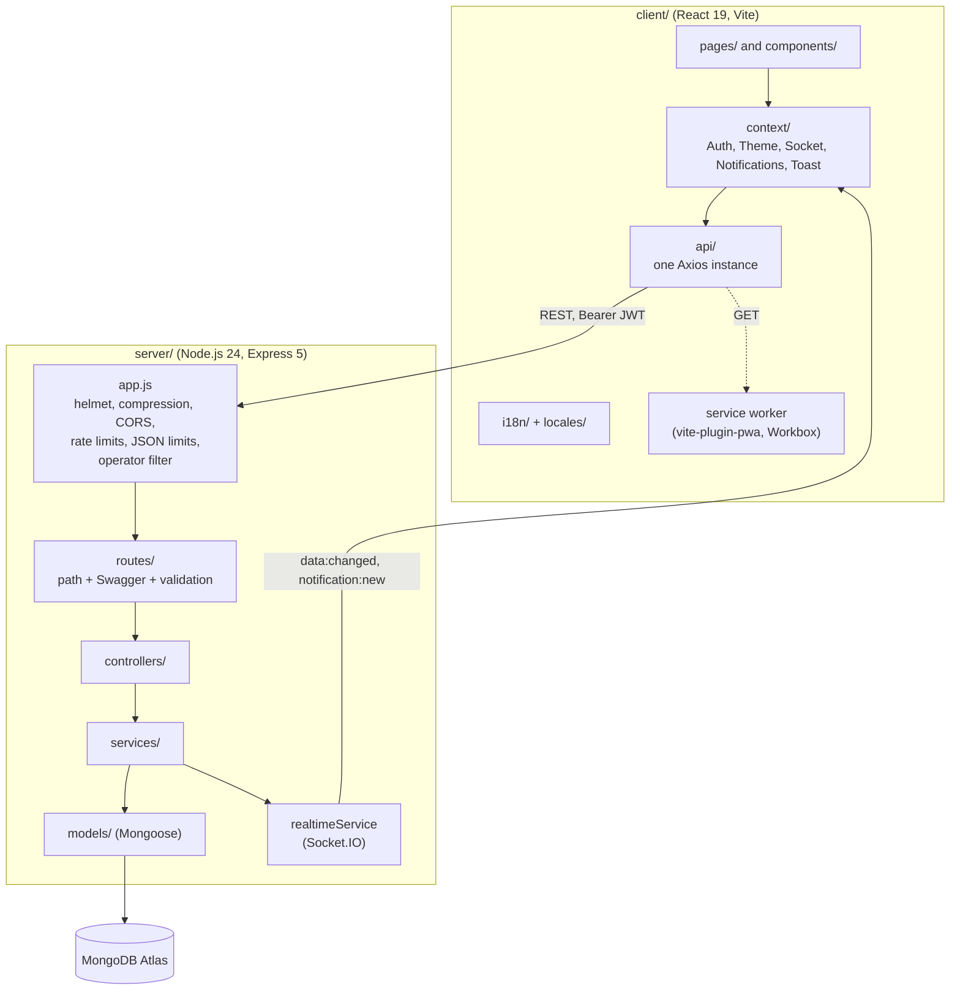
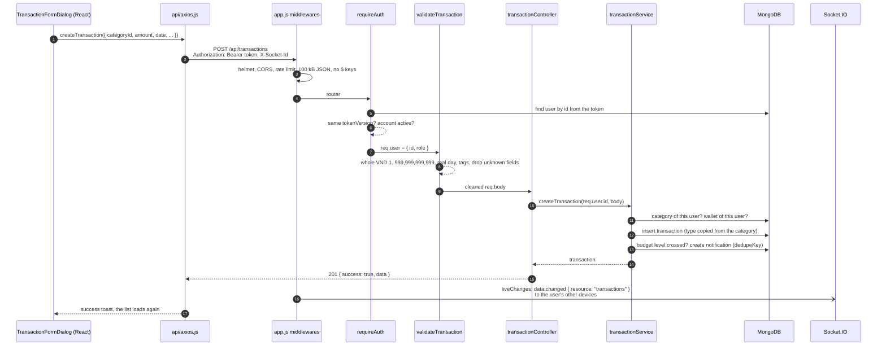

# Architecture

Ledgerling is a classic three-part web app: a React single-page app on Vercel, a REST API with Express on Render and a
MongoDB Atlas database. A Socket.IO server runs inside the same Node.js process as the API.

## Server layers

| Layer | Folder | Job | Example |
|-------|--------|-----|---------|
| App | `server/src/app.js` | Middlewares for every request: security headers, gzip, CORS allow-list, rate limits, body size, refusing MongoDB operators | `createApp()` |
| Route | `server/src/routes/` | The path, the Swagger comment and the chain of middlewares | `router.post("/", validateCreateTransaction, create)` |
| Middleware | `server/src/middlewares/` | `requireAuth`, `requireRole("admin")`, `blockDemo`, one `validate*.js` per resource, `liveChanges`, `errorHandler` | `validateTransaction.js` |
| Controller | `server/src/controllers/` | Reads `req`, calls one service, answers `{ success, data }` with the right status | `transactionController.create` |
| Service | `server/src/services/` | Business rules: ownership, money checks, recurring rules, balances, notifications | `transactionService.createTransaction` |
| Model | `server/src/models/` | Mongoose schemas and indexes | `Transaction.js` |

Errors are made with `httpError(status, message, code)` (`server/src/utils/httpError.js`) in any layer and turned into
`{ success: false, message, code }` by `errorHandler.js`. A stack trace never reaches the client.

## The walk of one request

What happens when a user saves a new expense on the Transactions page:

1. The page calls a function of `client/src/api/transactions.js`. Every call goes through `client/src/api/axios.js`,
   which adds the token from `localStorage` and the id of this device's socket.
2. `app.js` runs the shared middlewares. The rate limit counts the visitor by Cloudflare's `CF-Connecting-IP` header on
   Render, or `req.ip` elsewhere.
3. `requireAuth` verifies the JWT, then reads the user from the database: the token's `tv` must equal the user's
   `tokenVersion`, and the account must be `active`. So a changed password or a disabled account stops old tokens at once.
4. The validation middleware turns every field into the type it expects and refuses anything else with a stable code
   (`AMOUNT_INVALID`, `DATE_INVALID`, ...). Unknown fields are dropped, so a client can never set `userId` or `type`.
5. The service checks that the category and the wallet belong to the same user (another user's id answers 404), saves the
   transaction and may create a budget notification.
6. When the answer is sent, `liveChanges` (mounted in front of the whole router) tells the user's other devices that
   `transactions` changed. The device that made the change is skipped through `X-Socket-Id`.
7. On a 401 the Axios interceptor drops the token and the app shows "Session expired". Any other error is shown in the
   user's language from its `code` (`translateApiError`).

## Real-time sync

- `server/src/services/realtimeService.js` attaches Socket.IO to the HTTP server. The handshake sends the JWT and runs
  the same checks as `requireAuth`. Each socket joins the room `user:<id>`, so an event can only reach its own user.
- Events carry no data: `data:changed { resource }` and `notification:new { id, type }`. A client that hears one asks the
  normal, protected API again. A bug in the socket code can therefore never leak data.
- On the client, `SocketContext.jsx` owns the connection while someone is signed in. Pages subscribe through
  `useLiveRefresh(['transactions', 'categories'], refetch)`, which also refetches after a lost connection comes back.
- "Log out of all devices", a new password, a disabled or deleted account call `disconnectUser`, which closes every open
  socket of that user.

## Offline mode (PWA)

- `vite-plugin-pwa` builds a Workbox service worker with `registerType: 'autoUpdate'`. The built files are precached, so
  the app opens without a network.
- API reads (`GET /api/*`, except `/health` and the CSV export) use **NetworkFirst** with a 5 second timeout: online the
  answer is fresh; offline, or while the free server is waking up, the last saved copy is used (up to 200 answers, 7 days).
- The saved answers are deleted on logout and when another account signs in, so one person never sees another's data.
- While offline, an `OfflineBanner` is shown and every write button is disabled (`useOnline`): a write is never queued
  and replayed later, so nothing can be saved twice.
- The app can be installed from the browser or from **Settings → App**.

## Recurring rules without a cron job

The free Render server sleeps, so a timer would not run. Instead, `GET /transactions`, `/stats/summary`, `/budgets` and
`/recurring` first call `processDueRules(userId)`, which creates the transactions that are due up to today (Vietnam
time). Two guards make it safe when the Dashboard sends several requests at once: a partial unique index on
`(recurringRuleId, date)` and a conditional `findOneAndUpdate` that moves `nextRunDate` only from the value it read.

## Internationalization

- `client/src/i18n/index.js` sets up i18next with `react-i18next` and the browser language detector, reading only
  `localStorage` (`ledgerling.language`). The signed-in user's preference is applied when the app opens, so the choice
  follows the account across devices.
- `en.json` is part of the main bundle; the seven other languages are separate files loaded the first time they are
  chosen, which keeps the first page small.
- `<html lang>` follows the language, and `:lang(zh-CN)`, `:lang(ja)`, `:lang(ko)` switch to a system font of that script.
- Dates, months and numbers go through `Intl` in `client/src/utils/format.js`. Money is always VND.
- The API writes `message` in English for people reading logs and Postman, and a stable `code` that the client
  translates (`errors.<code>` in each locale file).
- `npm run i18n:check` fails when any language misses a key or has an extra one.

## Client structure

| Folder | Job |
|--------|-----|
| `src/api/` | One file per resource; nothing else in the app calls Axios |
| `src/context/` | Auth (token, user, session expired), theme, socket, notifications count, toasts, unsaved changes |
| `src/hooks/` | `useLoad` (loading, empty and error states), `useLiveRefresh`, `useOnline`, `useHotkeys`, `useUndoDelete`, `useTour` ... |
| `src/pages/` | One page per route, loaded with `React.lazy` |
| `src/components/` | Shared UI written by hand: Button, Modal, Drawer, Select, DatePicker, Toast, CommandPalette, Tour ... |
| `src/config/` | `navItems.js` (menu), breadcrumbs, the sections of Settings |
| `src/styles/tokens.css` | Every color, font, radius, shadow and spacing as CSS variables; components never hardcode them |
| `src/utils/` | Formatting, Vietnam dates, CSV, the quick-add parser, the API cache cleanup |

## Security in one place

| Where | What |
|-------|------|
| `app.js` | helmet headers, CORS allow-list from `CLIENT_URL`, rate limits, body size limits, `query parser: simple` |
| `middlewares/sanitizeInput.js` | refuses `$` keys and dotted keys in a body, `$` and `[` in a query |
| `middlewares/requireAuth.js` | JWT signature, expiry, `tokenVersion`, account status read from the database |
| `middlewares/requireRole.js`, `blockDemo.js` | admin-only routes, and what the shared demo account may not do |
| `services/*` | every query filtered by `userId` from the token; another user's id answers 404 |
| `client/vercel.json` | `X-Content-Type-Options`, `Referrer-Policy`, `X-Frame-Options`, `Permissions-Policy` |
