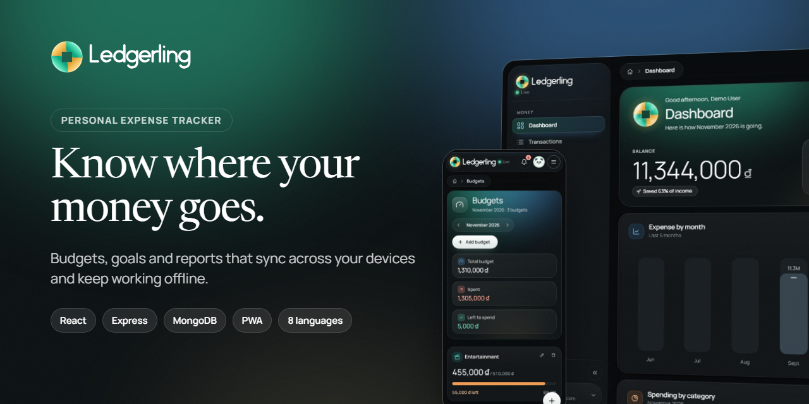

# Assets

Logo files and the social preview of the repository. The colors are the design tokens of the app
(`client/src/styles/tokens.css`); the logo itself is explained in [../brand/README.md](../brand/README.md).

| File | Size | Use |
|------|------|-----|
| [logo.svg](logo.svg) | 64 × 64, vector | the coin alone (same drawing as `client/public/favicon.svg`) |
| [logo.png](logo.png) | 512 × 512 | the coin as a picture, transparent background |
| [logo-wordmark-light.svg](logo-wordmark-light.svg) / [.png](logo-wordmark-light.png) | 276 × 64 / 828 × 192 | coin + name, ink letters for light backgrounds |
| [logo-wordmark-dark.svg](logo-wordmark-dark.svg) / [.png](logo-wordmark-dark.png) | 276 × 64 / 828 × 192 | coin + name, white letters for dark backgrounds |
| [social-preview.png](social-preview.png) | 1280 × 640 | the picture GitHub shows when the repository link is shared |

To use the social preview: **Settings → General → Social preview → Edit → Upload an image** and pick
`docs/assets/social-preview.png`.

