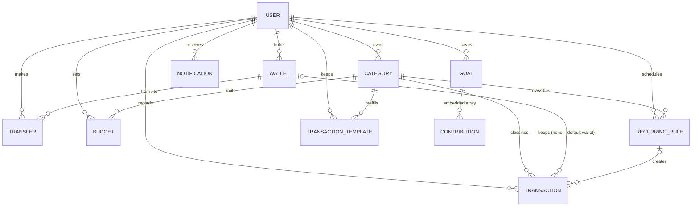

# Database

MongoDB Atlas with Mongoose 9. Ten collections; every document except a user carries the `userId` of its owner, and
every query of the API filters by the `userId` taken from the token. The complete ER diagram with every field is
[erd.md](erd.md) (a test compares it with the schemas); this page explains the model and the choices behind it.

## Models

Every model has `_id`, `createdAt` and `updatedAt` (Mongoose `timestamps`). Amounts are always **whole VND from 1 to
999,999,999,999** unless said otherwise, so sums stay exact without decimals.

### User (`users`)

| Field | Type | Rules |
|-------|------|-------|
| `name` | String | 1–50 characters |
| `email` | String | unique, lowercase, at most 254 characters |
| `passwordHash` | String | bcrypt hash; never sent to the client |
| `role` | `"user"` \| `"admin"` | default `user`; only `npm run make-admin` sets `admin` |
| `status` | `"active"` \| `"disabled"` | default `active`; a disabled user cannot log in |
| `tokenVersion` | Number | default 0; copied into each JWT as `tv`, raising it logs out every device |
| `preferences` | Object | `theme` (`light` \| `dark` \| `system`), `weekStartsOn` (`monday` \| `sunday`), `language` (one of 8), `notifications { budget, goals, recurring, weekly }` |
| `avatar` | Object, optional | `{ type: "preset", value: <id of 32 drawings> }` or `{ type: "upload", value: <256×256 WebP data URL, ≤ 120 kB> }` |

### Category (`categories`)

| Field | Type | Rules |
|-------|------|-------|
| `userId` | ObjectId → User | required |
| `name` | String | 1–30 characters, unique per user and type, ignoring case |
| `type` | `"income"` \| `"expense"` | cannot change after creation |
| `color` | String | hex `#RRGGBB` |
| `icon` | String, optional | an icon name of the app's set (`utensils`, `bus` ...) or one emoji; `null` = guessed from the name |

A new account gets a set of default categories with icons.

### Transaction (`transactions`)

| Field | Type | Rules |
|-------|------|-------|
| `userId` | ObjectId → User | required |
| `categoryId` | ObjectId → Category | one of the user's categories |
| `walletId` | ObjectId → Wallet | set on every new transaction; older ones have none and count in the default wallet |
| `type` | `"income"` \| `"expense"` | copied from the category, never sent by the client |
| `amount` | Number | whole VND |
| `currency` | String | ISO 4217, default `VND` |
| `note` | String | up to 200 characters |
| `tags` | [String] | up to 5, lowercase, each 1–20 of `a-z 0-9 -` |
| `recurringRuleId` | ObjectId → RecurringRule, optional | only on transactions made by a rule |
| `date` | Date | a real day of the years 1970–2100 |

### Wallet (`wallets`) and Transfer (`transfers`)

| Wallet field | Type | Rules |
|--------------|------|-------|
| `userId` | ObjectId → User | required |
| `name` | String | 1–30 characters, unique per user, ignoring case |
| `type` | `"cash"` \| `"bank"` \| `"ewallet"` | |
| `color` | String | hex |
| `initialBalance` | Number | whole VND from 0, default 0 |
| `archived` | Boolean | default false |
| `isDefault` | Boolean | the Cash wallet; one per user, set only by the server |

| Transfer field | Type | Rules |
|----------------|------|-------|
| `userId` | ObjectId → User | required |
| `fromWalletId`, `toWalletId` | ObjectId → Wallet | two different wallets of the user |
| `amount` | Number | whole VND |
| `note` | String | up to 200 characters |
| `date` | Date | |

### Budget (`budgets`)

| Field | Type | Rules |
|-------|------|-------|
| `userId` | ObjectId → User | required |
| `categoryId` | ObjectId → Category | an **expense** category of the user |
| `month` | String | `YYYY-MM` in Vietnam time; cannot change |
| `amount` | Number | the limit, whole VND |

`spent`, `remaining`, `percent` and `status` are not stored: they are computed from the month's expenses on each read.

### RecurringRule (`recurringrules`)

| Field | Type | Rules |
|-------|------|-------|
| `userId`, `categoryId` | ObjectId | the user and one of their categories |
| `amount`, `note` | Number, String | copied into each transaction |
| `frequency` | `"weekly"` \| `"monthly"` | |
| `startDate`, `nextRunDate` | Date | noon Vietnam time, so a day never slips across midnight |
| `endDate` | Date, optional | the last day that can run |
| `active` | Boolean | default true |

### Goal (`goals`) with embedded contributions

| Field | Type | Rules |
|-------|------|-------|
| `userId` | ObjectId → User | required |
| `name` | String | 1–60 characters |
| `targetAmount` | Number | whole VND |
| `savedAmount` | Number | default 0, never below 0 |
| `deadline` | Date, optional | noon Vietnam time |
| `color` | String | hex |
| `contributions` | [{ `amount`, `note`, `date` }] | `amount` > 0 is a deposit, < 0 a withdrawal |

### TransactionTemplate (`transactiontemplates`)

`userId`, `categoryId`, `name` (1–40 characters), `amount`, `note` (up to 200). It has no `type`: a transaction made from
it takes the type of the category.

### Notification (`notifications`)

| Field | Type | Rules |
|-------|------|-------|
| `userId` | ObjectId → User | required |
| `type` | String | `budget_warning`, `budget_over`, `goal_completed`, `recurring_created`, `weekly_summary` |
| `title`, `message` | String | English text (up to 100 / 300 characters) |
| `link` | String | a path inside the app |
| `params` | Object | the numbers and names the text was built from, so the client can write it in the user's language |
| `read` | Boolean | default false |
| `dedupeKey` | String | unique per user: one notification per event |

## Indexes

Every list and every check of the API reads through one of these; `server/tests/indexes.test.js` runs the main queries
with `explain()` and fails on a collection scan. Mongoose builds them on connect; one that cannot be built is logged by
name and the server keeps running.

| Collection | Index | Used by |
|------------|-------|---------|
| users | `email` unique | register, login |
| users | `(createdAt -1, _id -1)` | the account list of the Admin page |
| categories | `(userId, type, name)` unique, case-insensitive collation | the name check |
| transactions | `(userId, date -1)` | the list, month filters, stats, reports, insights |
| transactions | `(userId, categoryId, date -1)` | the category filter, budgets, the check before a category is deleted |
| transactions | `(userId, walletId, date -1)` | the wallet filter and the balances |
| transactions | `(userId, tags)` | the tag filter and the tag list |
| transactions | `(recurringRuleId, date)` unique, partial (only when `recurringRuleId` exists) | one transaction per rule and day |
| transactions | `createdAt` | Admin statistics |
| budgets | `(userId, categoryId, month)` unique | one budget per category and month |
| budgets | `(userId, month)` | the budgets of a month |
| recurringrules | `(userId, active, nextRunDate)` | the rules that are due |
| recurringrules | `(userId, categoryId)` | the check before a category is deleted |
| goals, transactiontemplates | `userId` (+ `categoryId` for templates) | the lists, deleting with a category |
| notifications | `(userId, dedupeKey)` unique | one notification per event, even when two requests race |
| notifications | `(userId, read, createdAt -1)`, `(userId, createdAt -1)` | the unread count and the list |
| wallets | `(userId, name)` unique, case-insensitive | the name check |
| wallets | `(userId, isDefault)` unique, partial (only when `true`) | one default wallet per user |
| transfers | `(userId, date -1)`, `(userId, fromWalletId)`, `(userId, toWalletId)` | the history and the balances |

The full list, with the single-field indexes, is in [erd.md](erd.md#indexes).

## Design decisions

- **References, not embedding, for transactions.** A user can have thousands of transactions, and every list is
  filtered, sorted and paged. A separate collection with compound indexes on `userId` keeps those queries fast and keeps
  each user document small.
- **Embedding for goal contributions.** A goal and its history are always read and changed together, and a goal has a
  few dozen contributions at most. `savedAmount` changes only through one atomic update that `$inc`s the amount and
  `$push`es or `$pull`s the contribution, with a condition that keeps it at 0 or more; no two requests can break it.
- **Computed, not stored, values.** Wallet balances (`initialBalance + income − expense + transfers in − transfers out`),
  budget progress and goal progress are added up on every read. A stored total could drift from the history; a
  computed one cannot.
- **`type` copied onto each transaction.** Stats and reports group by `type` without a `$lookup` to categories, and a
  category's type cannot change, so the copy can never go stale.
- **Transfers are not transactions.** Moving money between your own wallets is neither income nor expense, so it lives
  in its own collection and can never be counted by stats, budgets, reports or insights.
- **Vietnam time.** A "month" runs from the 1st at 00:00 +07:00 to the 1st of the next month at 00:00 +07:00. Dates
  that are only a day (rules, deadlines) are stored at noon Vietnam time, so no time zone can move them to another day.
- **Unique indexes as the last guard.** Duplicate names, budgets, notifications, default wallets and recurring
  transactions are checked in the service first (for a friendly 409), and refused by an index when two requests race.
- **Deletes.** Deleting a category is refused (409) while transactions or recurring rules use it, and it also deletes its
  budgets and templates. A wallet with history cannot be deleted, only archived. Deleting an account deletes every
  document with its `userId` in all nine other collections.
- **404 for someone else's data.** Asking for an id that belongs to another user answers the same 404 as an id that does
  not exist, so ids reveal nothing.
