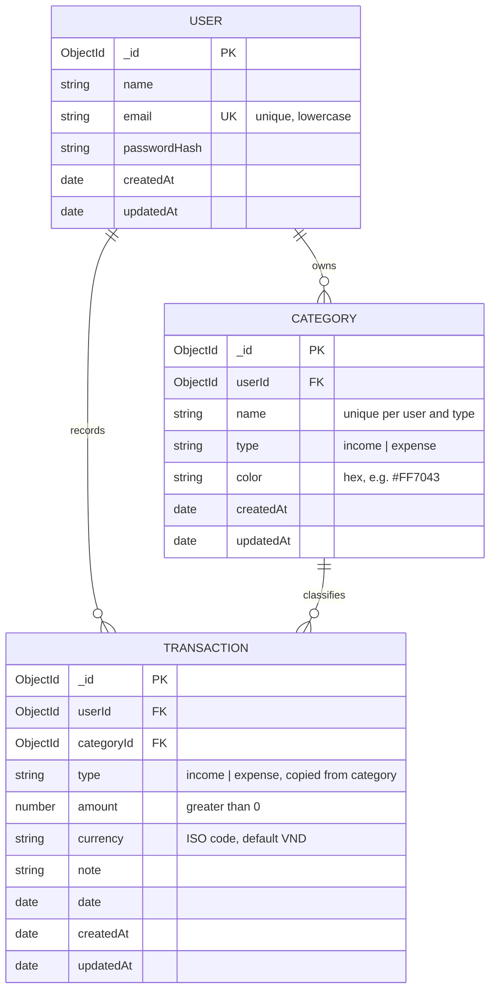

# Ledgerling – ERD

Paste the code block below into https://mermaid.live to render the diagram.

## Relationships

- One User has many Categories (`Category.userId`).
- One User has many Transactions (`Transaction.userId`).
- One Category has many Transactions (`Transaction.categoryId`).
- A Category cannot be deleted while it still has Transactions (API returns 409).
- Category name is unique per user and type: compound unique index on `(userId, name, type)`.
