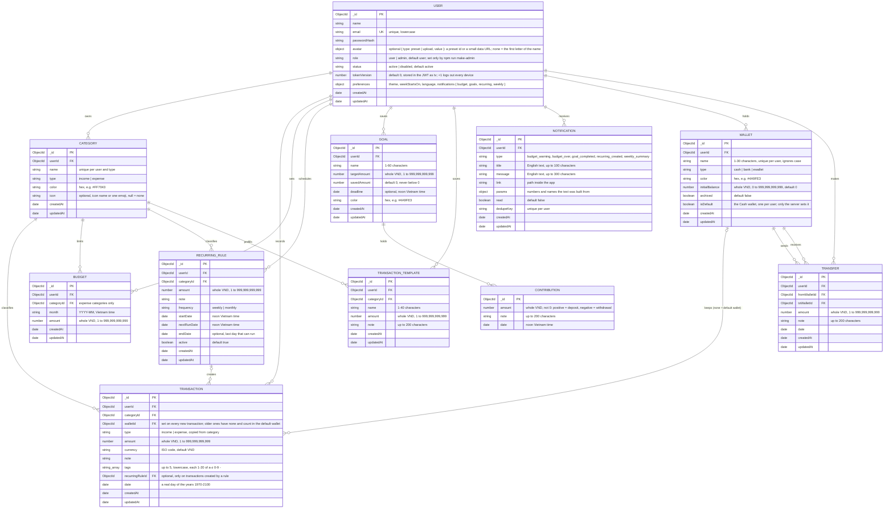

# Ledgerling – ERD

Paste the code block below into https://mermaid.live to render the diagram.

## Relationships

- One User has many Categories (`Category.userId`).
- One User has many Transactions (`Transaction.userId`).
- One Category has many Transactions (`Transaction.categoryId`).
- A Category cannot be deleted while it still has Transactions or Recurring Rules (API returns 409).
- One User has many Recurring Rules (`RecurringRule.userId`); one Category has many Recurring Rules (`RecurringRule.categoryId`).
- One Recurring Rule creates many Transactions (`Transaction.recurringRuleId`). Deleting a rule keeps its transactions, so the id can point to a rule that no longer exists.
- A rule never creates two transactions for the same date: partial unique index on `(recurringRuleId, date)`, only for transactions that have a `recurringRuleId`.
- Indexes on RecurringRule: `(userId, active, nextRunDate)` to find due rules and `(userId, categoryId)` for the check before a category is deleted.
- Category name is unique per user and type: compound unique index on `(userId, name, type)`.
- One User has many Budgets (`Budget.userId`); one Category has many Budgets (`Budget.categoryId`), one per month.
- A Budget is unique per user + category + month: compound unique index on `(userId, categoryId, month)` (API returns 409).
- `spent`, `remaining`, `percent` and `status` of a budget are not stored: they are computed from the month's VND expense transactions.
- Deleting a Category also deletes its Budgets (after the 409 check for transactions).
- Tags are stored inside the Transaction (no separate collection). `GET /api/tags` counts them with an aggregation.
- Indexes on Transaction: `(userId, date -1)` for the list and `(userId, tags)` for the tag filter and the tag list.
- One User has many Goals (`Goal.userId`). The contributions are stored inside the Goal as an array of subdocuments (no separate collection), so a goal and its history are always read and changed together.
- `Goal.savedAmount` is the sum of the contributions. It is changed only by an atomic `$inc` together with `$push` / `$pull` of a contribution, with a condition that keeps it at 0 or more.
- `progress`, `remaining` and `completed` of a goal are not stored: they are computed from `savedAmount` and `targetAmount`.
- Index on Goal: `(userId)` for the list.
- `Category.icon` is optional: an icon name from the app's icon set (`utensils`, `bus`, ...; list in `server/src/utils/categoryIcons.js`, max 30 characters) or one emoji saved by an older version. `null` = none chosen, and the client then guesses an icon from the name (nothing is written back). Default categories are created with an icon name; stored emoji are never rewritten, the client shows them as the matching line icon.
- One User has many Transaction Templates (`TransactionTemplate.userId`); one Category has many Templates (`TransactionTemplate.categoryId`). A template has no `type`: the type of a transaction made from it comes from the category.
- Deleting a Category also deletes its Templates (after the 409 checks for transactions and recurring rules).
- One User has many Notifications (`Notification.userId`). A notification is unique per user + event: compound unique index on `(userId, dedupeKey)`, so the same event (a budget level, a goal, a week) can never notify twice even when two requests race.
- Index on Notification: `(userId, read, createdAt -1)` for the list and the unread count.
- `Notification.params` is an extra field next to the ones in the data model: it keeps the numbers and names, so the app can write the text in the user's language.
- `User.preferences.notifications` has one boolean per kind (`budget`, `goals`, `recurring`, `weekly`). A user without the field counts as all on. A kind that is off is not created at all.
- `User.tokenVersion` (Number, default 0) is copied into every JWT as `tv`. `requireAuth` compares the two on each request, so raising it (new password, "log out of all devices") makes every older token invalid. It is never sent to the client.
- `User.preferences.theme` (`light` | `dark` | `system`, default `dark`), `weekStartsOn` (`monday` | `sunday`, default `monday`) and `language` (one of the 8 app languages, no default: until it is chosen each device keeps its own).
- `User.avatar` (optional) is `{ type, value }`: `preset` + the id of one of the 32 ready-made avatars (`server/src/utils/avatars.js`, drawings in `client/src/assets/avatars`), or `upload` + a data URL of a 256x256 WebP made in the browser (at most 120 kB). A new account gets a random preset; the demo account has the fixed preset `panda`. No separate collection: a photo is small enough to live in the user document.
- `User.role` (`user` | `admin`, default `user`) and `User.status` (`active` | `disabled`, default `active`). Only `server/src/scripts/make-admin.js` sets a role; no API route can. `requireAuth` reads both from the database on every request. Disabling an account (`PATCH /admin/users/:id/status`) also raises `tokenVersion`, so its tokens stop working; a disabled user cannot log in (403).
- One User has many Wallets (`Wallet.userId`). The name is unique per user, ignoring case: compound unique index with a collation on `(userId, name)`. One default wallet per user: partial unique index on `(userId, isDefault)`, only for `isDefault: true`, so two requests at the same time can never make two.
- `balance` of a wallet is not stored: it is `initialBalance + income − expense + transfersIn − transfersOut`, added up on every read from the VND transactions and the transfers.
- `Transaction.walletId` is not "required" in the schema: a transaction saved before wallets existed has none and must still save when it is edited. The service sets it on every new transaction (the chosen wallet, or the default one). Without it a transaction counts in the default wallet (`$ifNull` in the balance, `$in: [id, null]` in the filter). Nothing is migrated.
- A wallet with transactions or transfers cannot be deleted (409), because the balances would change: it can be archived. The default wallet can be neither.
- One User has many Transfers (`Transfer.userId`). A transfer is a separate collection and not a transaction, so stats, budgets, reports and insights can never count it.
- Indexes: on Transaction `(userId, walletId, date -1)` for the wallet filter; on Transfer `(userId, date -1)` for the history, `(userId, fromWalletId)` and `(userId, toWalletId)` for the balances and the check before a wallet is deleted.
- Deleting a User deletes every document with that `userId`: Category, Transaction, Budget, RecurringRule, Goal, TransactionTemplate, Notification, Wallet and Transfer.
- Every amount is a whole number of VND (the API refuses decimals and more than 12 digits, `AMOUNT_INVALID`), so sums stay exact.

## Indexes

Every list and every check of the API reads through one of these (`server/tests/indexes.test.js` checks the main
queries with `explain()`). Mongoose builds them when the server connects; one that cannot be built is named in the log
(`logIndexErrors` in `server/src/config/db.js`) and the server keeps running.

| Collection | Index | Used by |
|------------|-------|---------|
| users | `email` unique | register, login |
| users | `(createdAt -1, _id -1)` | the account list of the Admin page, newest first |
| categories | `(userId, type, name)` unique, ignoring case | the name check of a new category |
| categories | `userId` | the list |
| transactions | `(userId, date -1)` | the list, the month filter, stats, reports, insights |
| transactions | `(userId, categoryId, date -1)` | the category filter, budgets, the check before a category is deleted |
| transactions | `(userId, walletId, date -1)` | the wallet filter and the balances |
| transactions | `(userId, tags)` | the tag filter and the tag list |
| transactions | `userId`, `categoryId` | counting and deleting the transactions of a user or a category |
| transactions | `createdAt` | the Admin statistics (transactions per day) |
| transactions | `(recurringRuleId, date)` unique, only when `recurringRuleId` is set | one transaction per rule and date |
| budgets | `(userId, categoryId, month)` unique | one budget per category and month |
| budgets | `(userId, month)` | the budgets of a month |
| budgets | `userId` | deleting the budgets of a user |
| recurringrules | `(userId, active, nextRunDate)` | the rules that are due |
| recurringrules | `(userId, categoryId)` | the check before a category is deleted |
| goals | `userId` | the list |
| transactiontemplates | `userId`, `categoryId` | the list, deleting the templates of a category |
| notifications | `(userId, dedupeKey)` unique | one notification per event |
| notifications | `(userId, read, createdAt -1)` | the unread filter and count |
| notifications | `(userId, createdAt -1)` | the list |
| wallets | `(userId, name)` unique, ignoring case | the name check |
| wallets | `userId` | the list |
| wallets | `(userId, isDefault)` unique, only when `isDefault` is true | one default wallet per user |
| transfers | `(userId, date -1)` | the history |
| transfers | `(userId, fromWalletId)` and `(userId, toWalletId)` | the balances, the check before a wallet is deleted |
