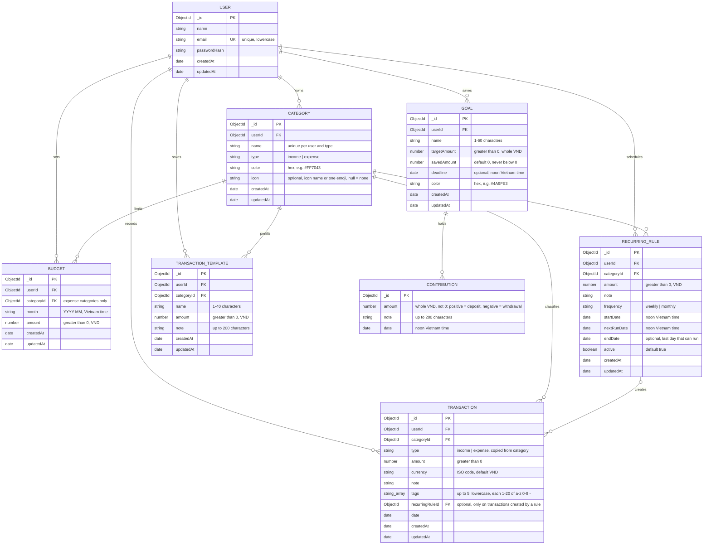

# Ledgerling – ERD

Paste the code block below into https://mermaid.live to render the diagram.

## Relationships

- One User has many Categories (`Category.userId`).
- One User has many Transactions (`Transaction.userId`).
- One Category has many Transactions (`Transaction.categoryId`).
- A Category cannot be deleted while it still has Transactions or Recurring Rules (API returns 409).
- One User has many Recurring Rules (`RecurringRule.userId`); one Category has many Recurring Rules (`RecurringRule.categoryId`).
- One Recurring Rule creates many Transactions (`Transaction.recurringRuleId`). Deleting a rule keeps its transactions, so the id can point to a rule that no longer exists.
- A rule never creates two transactions for the same date: partial unique index on `(recurringRuleId, date)`, only for transactions that have a `recurringRuleId`.
- Indexes on RecurringRule: `(userId, active, nextRunDate)` to find due rules and `(userId, categoryId)` for the check before a category is deleted.
- Category name is unique per user and type: compound unique index on `(userId, name, type)`.
- One User has many Budgets (`Budget.userId`); one Category has many Budgets (`Budget.categoryId`), one per month.
- A Budget is unique per user + category + month: compound unique index on `(userId, categoryId, month)` (API returns 409).
- `spent`, `remaining`, `percent` and `status` of a budget are not stored: they are computed from the month's VND expense transactions.
- Deleting a Category also deletes its Budgets (after the 409 check for transactions).
- Tags are stored inside the Transaction (no separate collection). `GET /api/tags` counts them with an aggregation.
- Indexes on Transaction: `(userId, date -1)` for the list and `(userId, tags)` for the tag filter and the tag list.
- One User has many Goals (`Goal.userId`). The contributions are stored inside the Goal as an array of subdocuments (no separate collection), so a goal and its history are always read and changed together.
- `Goal.savedAmount` is the sum of the contributions. It is changed only by an atomic `$inc` together with `$push` / `$pull` of a contribution, with a condition that keeps it at 0 or more.
- `progress`, `remaining` and `completed` of a goal are not stored: they are computed from `savedAmount` and `targetAmount`.
- Index on Goal: `(userId)` for the list.
- `Category.icon` is optional: an icon name from the app's icon set (`utensils`, `bus`, ...; list in `server/src/utils/categoryIcons.js`, max 30 characters) or one emoji saved by an older version. `null` = none chosen, and the client then guesses an icon from the name (nothing is written back). Default categories are created with an icon name; stored emoji are never rewritten, the client shows them as the matching line icon.
- One User has many Transaction Templates (`TransactionTemplate.userId`); one Category has many Templates (`TransactionTemplate.categoryId`). A template has no `type`: the type of a transaction made from it comes from the category.
- Deleting a Category also deletes its Templates (after the 409 checks for transactions and recurring rules).
