# Screenshots

Every picture comes from the demo account of the end-to-end API (an in-memory database filled with the same sample data
as `npm run seed`), with reduced motion so the charts are in their final state. No real account or e-mail appears:
the demo user is `demo@example.com` and the admin is a test account. The light pictures and the German and Japanese
ones are made again with `npm run screenshots:docs` in `client/`.

Naming: `<page>-<width>.jpg` for the light theme, `<page>-dark-<width>.jpg` for the dark theme; 1440 is a laptop
(1440 × 900), 390 a phone (390 × 844 at 2× pixels).

| Page | Desktop, light | Desktop, dark | Phone, light | Phone, dark |
|------|----------------|---------------|--------------|-------------|
| Landing page (`/welcome`, always dark) | [1440](welcome-1440.jpg) | – | [390](welcome-390.jpg) | – |
| Dashboard | [1440](dashboard-1440.jpg) | [1440 dark](dashboard-dark-1440.jpg) | [390](dashboard-390.jpg) | [390 dark](dashboard-dark-390.jpg) |
| Transactions | [1440](transactions-1440.jpg) | [1440 dark](transactions-dark-1440.jpg) | [390](transactions-390.jpg) | [390 dark](transactions-dark-390.jpg) |
| Transaction details | [1440](transaction-drawer-1440.jpg) | – | [390](transaction-drawer-390.jpg) | – |
| Categories | [1440](categories-1440.jpg) | – | [390](categories-390.jpg) | – |
| Wallets | [1440](wallets-1440.jpg) | [1440 dark](wallets-dark-1440.jpg) | [390](wallets-390.jpg) | – |
| Budgets | [1440](budgets-1440.jpg) | [1440 dark](budgets-dark-1440.jpg) | [390](budgets-390.jpg) | [390 dark](budgets-dark-390.jpg) |
| Recurring | [1440](recurring-1440.jpg) | – | [390](recurring-390.jpg) | – |
| Goals | [1440](goals-1440.jpg) | [1440 dark](goals-dark-1440.jpg) | [390](goals-390.jpg) | – |
| Monthly report | [1440](reports-monthly-1440.jpg) | [1440 dark](reports-monthly-dark-1440.jpg) | [390](reports-monthly-390.jpg) | [390 dark](reports-monthly-dark-390.jpg) |
| Yearly report | [1440](reports-yearly-1440.jpg) | – | [390](reports-yearly-390.jpg) | – |
| Spending calendar | [1440](reports-calendar-1440.jpg) | [1440 dark](reports-calendar-dark-1440.jpg) | [390](reports-calendar-390.jpg) | – |
| Notifications | [1440](notifications-1440.jpg) | – | [390](notifications-390.jpg) | – |
| Settings | [1440](settings-1440.jpg) | – | [390](settings-390.jpg) | – |
| Command palette (`Ctrl+K`) | [1440](command-palette-1440.jpg) | – | [390](command-palette-390.jpg) | – |
| Admin | [1440](admin-1440.jpg) | – | [390](admin-390.jpg) | – |

Other languages: [Dashboard in German](dashboard-de-1440.jpg), [Dashboard in Japanese](dashboard-ja-1440.jpg).

## Preview

| | |
|---|---|
| 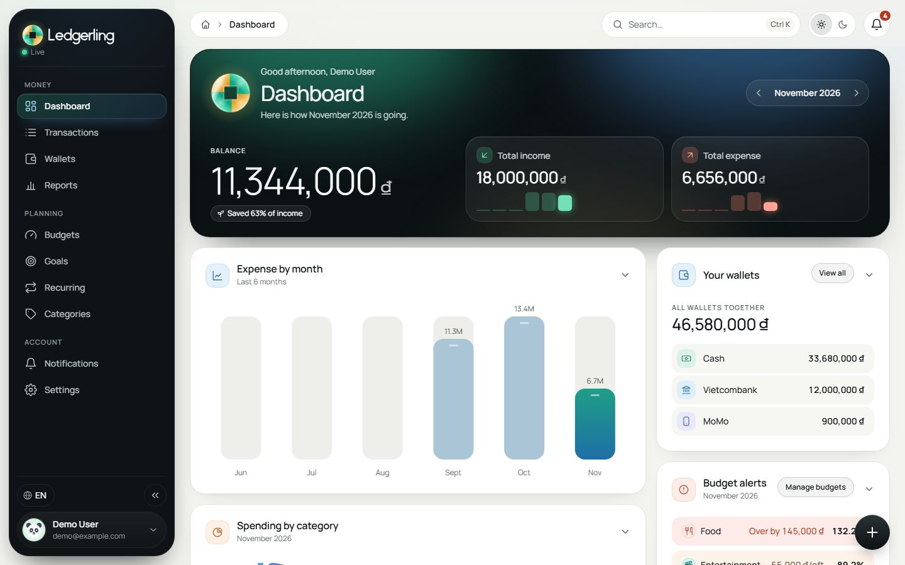 | 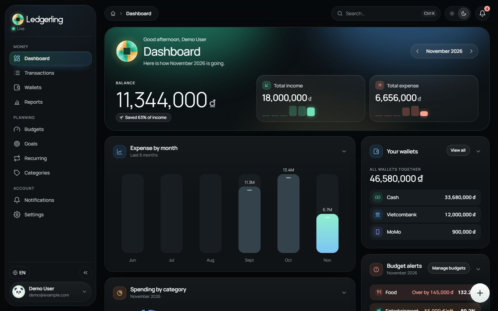 |
| 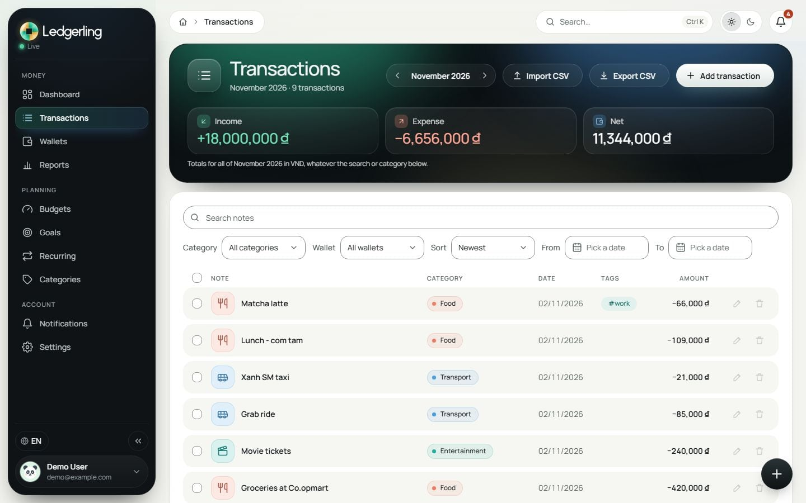 | 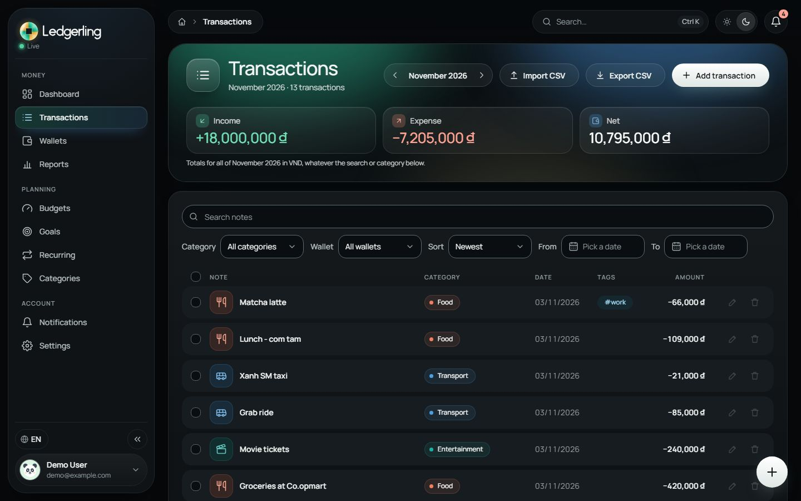 |
| 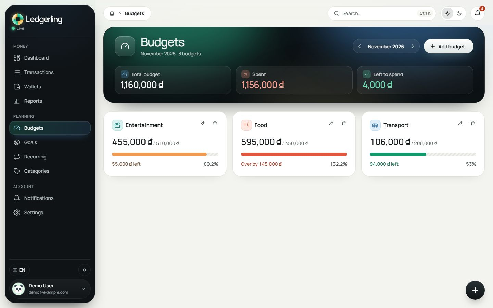 | 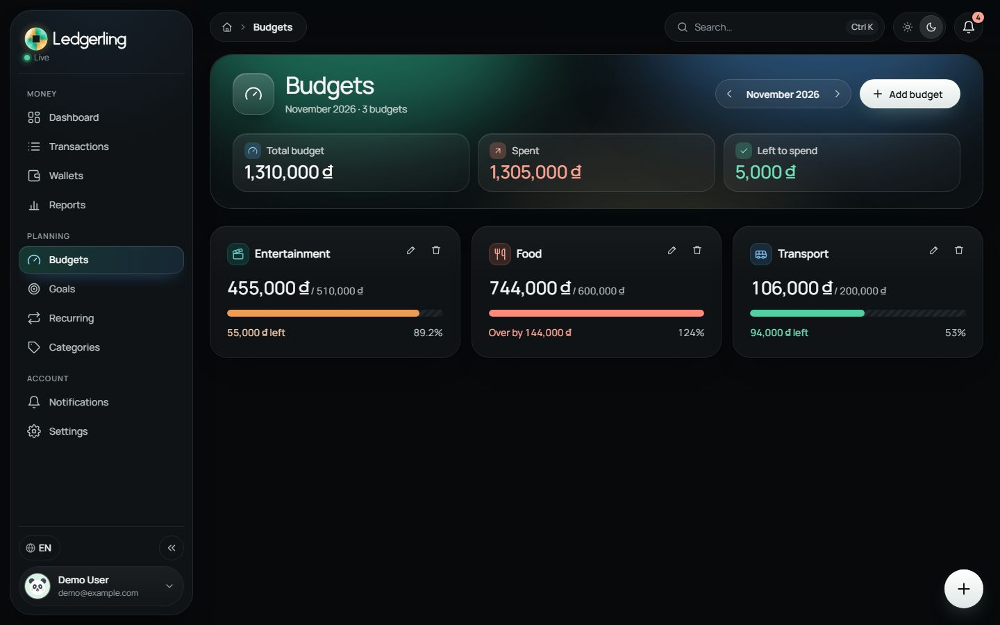 |

  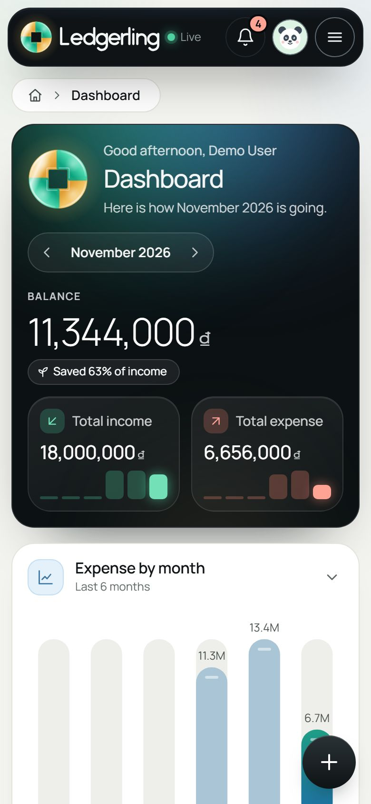
  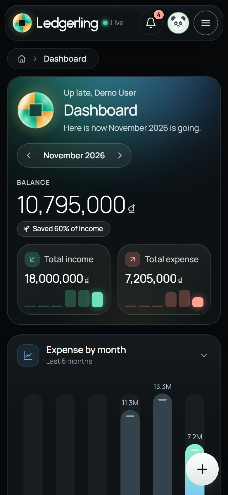
  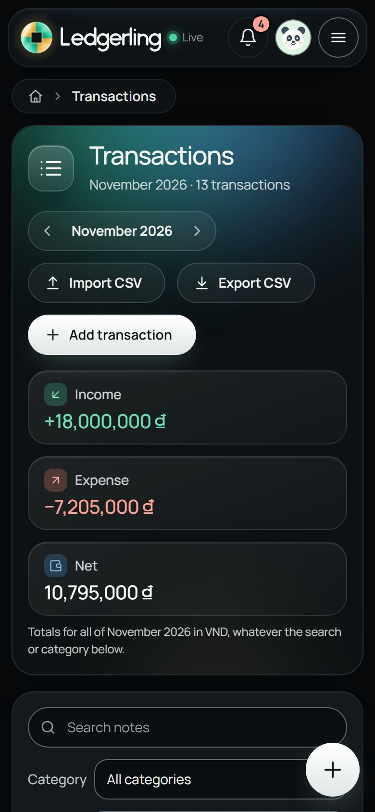
  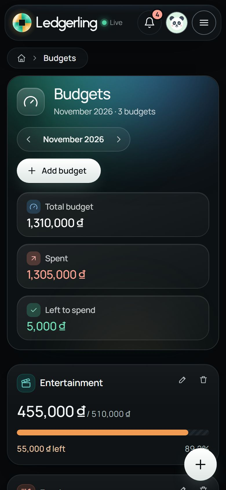
  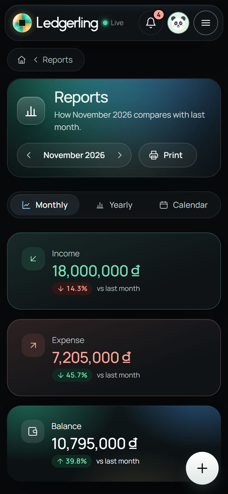

